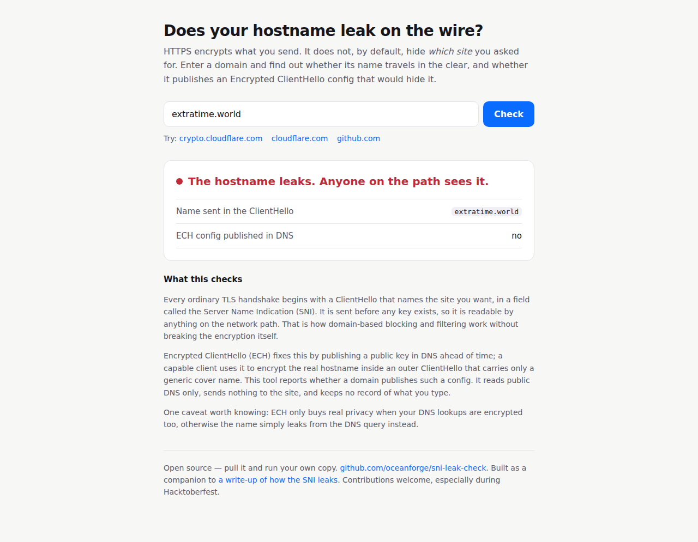
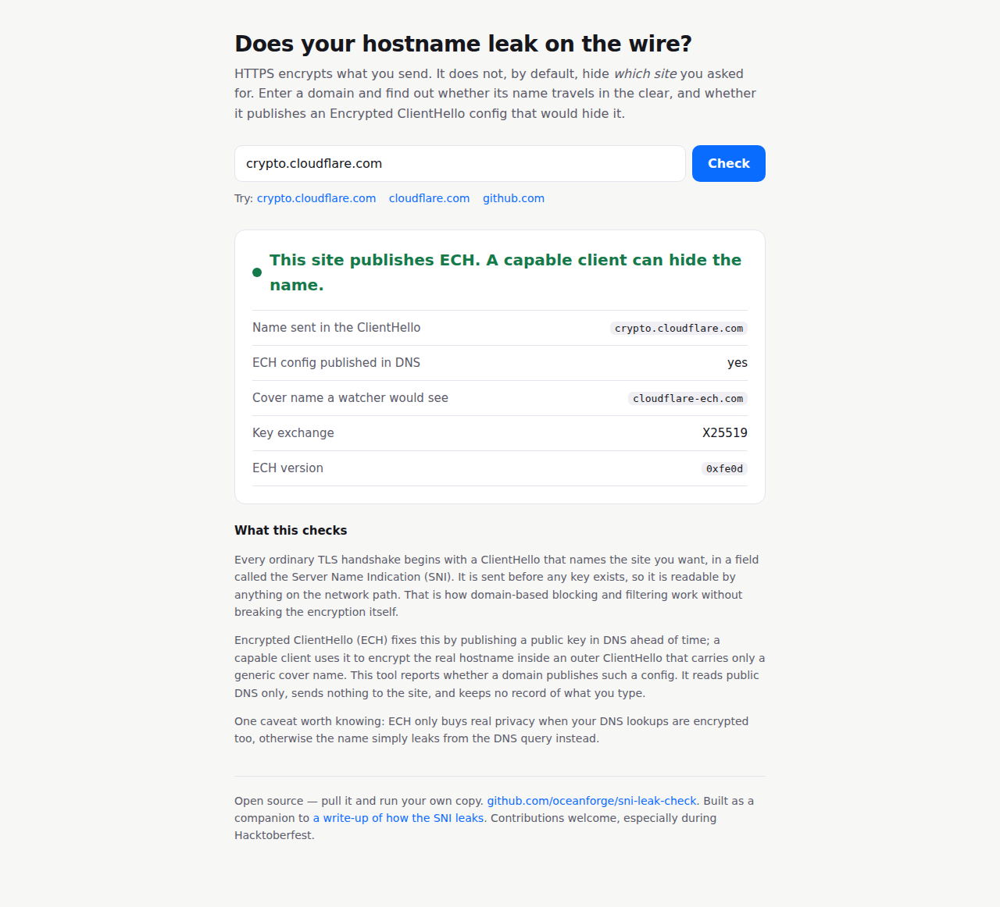

# sni-leak-check

A tiny web app that tells you whether a site's hostname leaks on the wire, and
whether it publishes an [Encrypted ClientHello](https://datatracker.ietf.org/doc/draft-ietf-tls-esni/)
(ECH) config that would hide it.

HTTPS encrypts what you send. It does not, by default, hide **which site** you
asked for: the hostname travels in plaintext in the TLS ClientHello, in TLS 1.3
too. This tool reads a domain's public DNS to report whether it has published an
ECH config, and shows the cover name a network watcher would see if it had.



It reads public DNS only. It sends nothing to the site you check and keeps no
record of what you type.

## Run your own copy

With Docker:

```bash
docker run -p 8000:8000 ghcr.io/oceanforge/sni-leak-check:latest
# then open http://localhost:8000

Without Docker:

```bash
pip install -r requirements.txt
uvicorn app.main:app --reload
```

## What it reports



- **Name sent in the ClientHello** — the hostname a passive listener reads off the wire.
- **ECH config published in DNS** — whether the site has published a key that lets a capable client encrypt that name.
- **Cover name** — with ECH, the decoy hostname a watcher sees instead.
- The ECH version and key-exchange algorithm, decoded from the DNS record.

There is one command-line helper too: `python3 survey.py domains.txt` runs the
check across a list and reports how many publish ECH. Across the top 1000
domains when this was written, ten did.

## How it works

The check is one function in `app/ech.py`. It fetches the DNS HTTPS (type 65)
record over DoH, looks for an `ech=` parameter, and decodes the ECHConfig far
enough to read the version, the KEM and the `public_name`. No TLS handshake is
performed and no key is needed, which is exactly the point: the interesting
information is all in the open.

## Contributing

Issues and pull requests are welcome, and especially so during Hacktoberfest.
Look at the [good first issues](https://github.com/oceanforge/sni-leak-check/issues?q=is%3Aissue+is%3Aopen+label%3A%22good+first+issue%22)
for small, self-contained ways to extend it.

## Licence

MIT. See [LICENSE](LICENSE).
